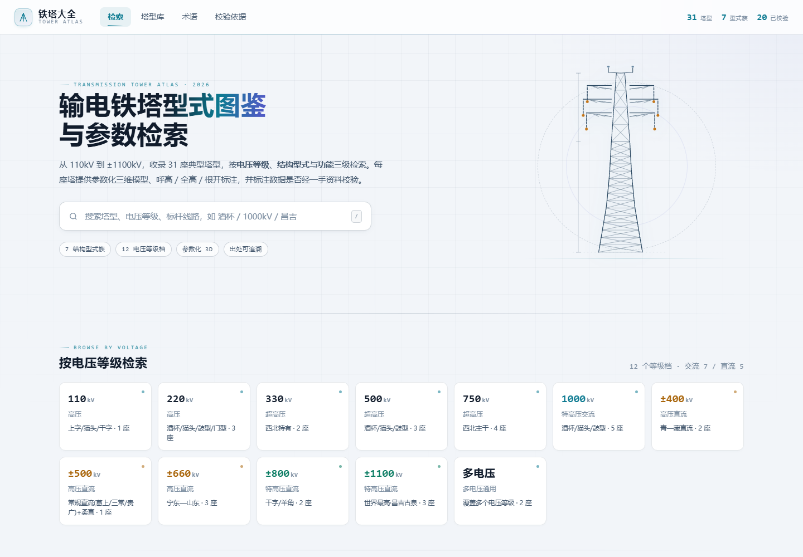
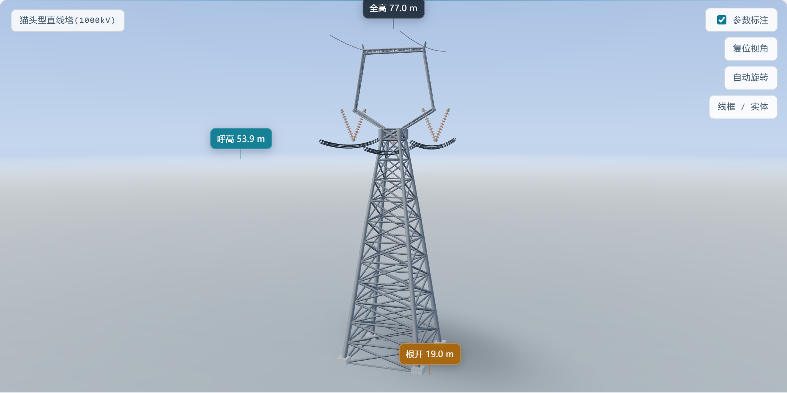
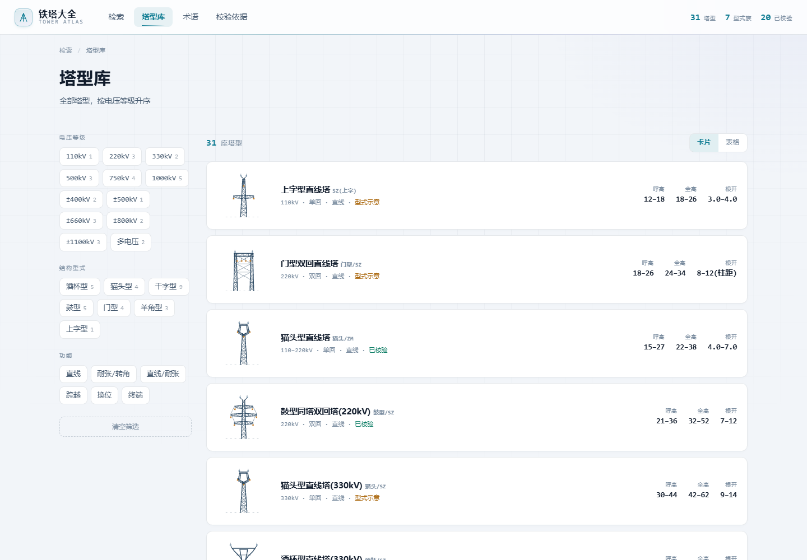
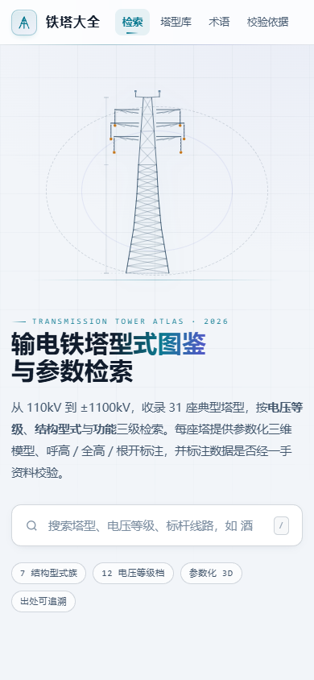

# 铁塔大全 · 输电铁塔型式图鉴与检索

**在线访问**：https://moonquake2004.github.io/tower-atlas/

一个**单文件、完全离线**的输电铁塔图鉴网页：收录 110 kV ~ ±1100 kV 共 **31 座典型塔型**，每座塔都带参数化三维模型、程序化立面图、呼高/全高/根开标注与可追溯的出处。

双击 `铁塔大全.html` 即可打开，不需要服务器、不需要联网——Three.js 以 base64 内联在文件里。



## 功能

- **31 座塔 · 7 种型式**：上字型、猫头型、酒杯型、干字型、门型、鼓型、羊角型
- **参数化三维模型**：全部用代码按杆件搭建（塔身格构、横担、绝缘子串、导线弧垂），没有使用任何照片或贴图，可自由旋转、线框/实体切换、自动旋转
- **自动标注**：从几何体反算呼高、全高、根开，直接标在模型上
- **程序化立面图**：SVG 按型式绘制二维正立面，缩放不失真
- **三级检索**：电压等级 → 型式 → 功能（直线/耐张/转角/跨越）
- **移动端适配**：手机浏览器可用





## 快速开始

直接用浏览器打开 `铁塔大全.html`。

### 从源码重新构建

页面由多个模块拼装而成，改动任何片段后都要重新构建：

```bash
python assets/ui/build_site.py
# → built 铁塔大全.html  1.02 MB  ...
```

## 目录结构

```
铁塔大全.html            # 构建产物（单文件，可直接分发）
assets/
  viewer3d.js            # 三维引擎：塔身/横担/绝缘子串/导线弧垂
  ui/
    build_site.py        # 把下面这些片段拼成单文件
    d_towers.js          # 31 座塔的数据表
    d_vlevels.js         # 电压等级分组
    d_terms.js           # 术语表
    d_svg.js             # 程序化立面图（SVG）
    app.js               # 视图、路由、检索
    style.css
    body.html
    d_importmap.html     # Three.js 的 base64 内联 importmap
    d_imports.js
    # 开发辅助脚本
    sweep.py             # 遍历全部塔型做回归核验（截图 + 报错收集）
    shot3d.py            # 单座塔三维截图
    check_cat.py         # 单型式立面放大渲染
    board.py             # 型式总览板
```

## 技术实现

- **Three.js 0.160.0** + OrbitControls + CSS2DRenderer，全部以 `data:text/javascript` 内联，做到零外部依赖
- `THREE.InstancedMesh` 批次渲染：一座塔上千根杆件按材质合批，移动端也能流畅旋转
- PMREM 环境贴图 + 接触阴影，无外部 HDRI 文件
- 导线/地线用抛物线近似弧垂，**塔位是曲线的最高点**，向两侧渐降
- 立面图用 SVG，`vector-effect="non-scaling-stroke"` 保证任意缩放下线宽恒定

## 关于数据

塔型的电压等级、根开、呼高、全高、绝缘子配置、适用条件等参数整理自公开资料（国网通用设计模块、典型工程设计参数、公开文献等），数据表中带 `verified` 标记：

- `verified: true` —— 有明确工程出处
- `verified: false` —— 为通用范围值，仅供参考

**三维模型是按塔型特征做的示意性重建，用于认识塔型结构，不能替代设计图纸或厂家图纸。** 若发现某座塔的构件关系与图纸不符，欢迎提 Issue 并附图纸。

## 许可

页面中出现的标准编号、工程名称等归各自权利人所有；本项目代码与程序化模型可自由参考。
