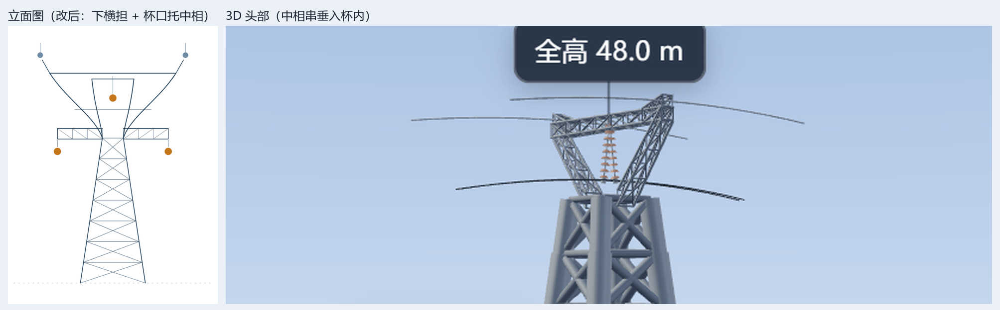

# 铁塔大全 · 输电铁塔型式图鉴与检索

**在线访问**：https://moonquake2004.github.io/tower-atlas/

一个**单文件、完全离线**的输电铁塔图鉴网页：收录 110 kV ~ ±1100 kV 共 **31 座典型塔型**，每座塔都带参数化三维模型、程序化立面图、呼高/全高/根开标注与可追溯的出处。

双击 `铁塔大全.html` 即可打开，不需要服务器、不需要联网——Three.js 以 base64 内联在文件里。


## 功能

- **31 座塔 · 7 种型式**：上字型、猫头型、酒杯型、干字型、门型、鼓型、羊角型
- **参数化三维模型**：全部用代码按杆件搭建（塔身格构、横担、绝缘子串、导线弧垂），没有使用任何照片或贴图，可自由旋转、线框/实体切换、自动旋转
- **自动标注**：从几何体反算呼高、全高、根开，直接标在模型上
- **程序化立面图**：SVG 按型式绘制二维正立面，缩放不失真
- **三级检索**：电压等级 → 型式 → 功能（直线/耐张/转角/跨越）
- **移动端适配**：手机浏览器可用


## 塔型是怎么"认"出来的

程序化建模不能只求形似，每种型式都有一条结构判据。以酒杯型为例：



- **杯腰的下横担**挂两边相（最低）
- **杯口横梁跨中**垂下中相（最高，其下无塔身构件，串垂进杯内）
- **杯口两端**挂地线

三相是三角形排列、中相高、边相低，这个「杯口托住中相」的关系就是酒杯塔区别于一般的判据。如果中相改挂杯腰中央，悬垂串会整根埋进塔身，而且三相变成同一水平面，就已经不是酒杯塔了。

同理，猫头塔的判据是「宽顶窄颏」的头部轮廓加 V 形下颌，上字型的判据是顶尖挂顶相——这些判据都写在 `assets/viewer3d.js` 各分支的注释里。

## 快速开始

直接用浏览器打开 `铁塔大全.html`。

### 从源码重新构建

页面由多个模块拼装而成，改动任何片段后都要重新构建：

```bash
python assets/data/gen_towers_js.py    # towers.json → d_towers.gen.js（build_site 会自动做）
python assets/ui/build_site.py         # → built 铁塔大全.html  1.03 MB  ...
```

### 校验数据

```bash
python assets/data/validate.py         # 结构 + 一致性 + 完整性（CI 会跑这一步）
python assets/data/validate.py --live  # 追加三维实测：逐塔比对渲染结果与数据区间
```

`--live` 需要 `playwright` 和 Chrome，会真的把 31 座塔在浏览器里逐一渲染，读出实际算出的全高 / 挂点高度 / 根开，反查 `towers.json` 里的区间。数据与几何一旦脱节，这里就会报错。

## 目录结构

```
铁塔大全.html            # 构建产物（单文件，可直接分发）
assets/
  viewer3d.js            # 三维引擎：塔身/横担/绝缘子串/导线弧垂
  data/
    towers.json          # ★ 唯一数据源：31 座塔的全部参数
    towers.schema.json   # 数据格式定义（JSON Schema draft-07）
    gen_towers_js.py     # JSON → 网页内联的 JS 字面量
    validate.py          # 四层校验：结构 / 一致性 / 完整性 / 三维实测
    rangeutil.py         # 参数区间文本解析（"≤63"、"约10–14"、"8–12(柱距)"）
  ui/
    build_site.py        # 把下面这些片段拼成单文件
    d_towers.gen.js      # 自动生成，勿手改 —— 由 towers.json 生成
    d_vlevels.js         # 电压等级分组
    d_terms.js           # 术语表
    d_svg.js             # 程序化立面图（SVG）
    app.js               # 视图、路由、检索
    style.css
    body.html
    d_importmap.html     # Three.js 的 base64 内联 importmap
    d_imports.js
    # 开发辅助脚本
    sweep.py             # 遍历全部塔型粗查（报错 + 标注）
    shot3d.py            # 单座塔三维截图
    check_cat.py         # 单型式立面放大渲染
    board.py             # 型式总览板
```

## 改数据：只改一个地方

塔型参数全部在 `assets/data/towers.json`。网页里的数据表、三维模型、立面图、参数列表都从这一份生成，不再各算各的。

```jsonc
{
  "id": "cat110",                       // 稳定标识，URL 片段 #/t/cat110，发布后不要改
  "shape": "cat",                       // 型式，必须是 shapeCatalog 里的键
  "ranges": {                           // 参数区间：文本给人看，min/max 给机器算
    "hCall":    { "text": "15–27", "min": 15, "max": 27, ... },
    "hTotal":   { "text": "22–38", "min": 22, "max": 38, ... },
    "rootOpen": { "text": "4.0–7.0", "min": 4,  "max": 7,  ... }
  },
  "spec": {
    "bundle": 2,                        // 分裂数，显式给出，不再从中文描述里猜
    "insulatorType": "I"                // I 悬垂 / V 形 / II 双串 / T 耐张
  },
  "render": {
    "height": 32, "rootOpen": 6,        // 三维模型的基准尺寸（米），必须落在上面的区间内
    "callBasis": "hCall"                // attachment = 资料没给呼高，标注只能写「导线挂点」
  },
  "source": { "verified": true, "line": "国网通用设计 220kV HD22D 模块 ZMC2 直线猫头塔" }
}
```

改完运行：

```bash
python assets/data/gen_towers_js.py && python assets/data/validate.py && python assets/ui/build_site.py
```

### 校验器实际会拦下的东西

| 层 | 检查什么 | 典型错误 |
|---|---|---|
| L1 结构 | 是否符合 `towers.schema.json` | 字段拼错、类型不对、漏了必填项 |
| L2 一致性 | 区间文本与 min/max 是否一致、min ≤ max、呼高 ≤ 全高、三维基准是否落在数据区间内 | 改了数值忘了改文本；三维全高 95 m 而资料给 70–90 m |
| L3 完整性 | 每种型式在 `viewer3d.js` 与 `d_svg.js` 里是否都有渲染分支、生成物是否与数据源同步 | 新增型式只写了数据没写图形；改完 JSON 忘了重新生成 |
| L4 实测 | 打开页面逐塔渲染，比对全高 / 挂点高度 / 根开 / 型式 / 标注用词 | 数据说根开 13 m，实际画出来 12 m；标注该写「导线挂点」却写成了「呼高」 |

最后一条尤其有用：**「呼高」几乎等于「全高」**这种矛盾（耐张塔、跨越塔、门型塔的导线挂在结构顶部附近）就是 L4 抓出来的。

### 已知数据缺口

校验器目前报 9 条 WARNING，都是资料本身没写清楚、我没有替它编的：

- `portal220`、`ram800`、`ram1100`、`transpos`、`terminal` 的导线分裂数原文未给出，三维按 1 分裂示意
- `stem800`、`stem660`、`cross1100` 的绝缘串型原文是「悬垂/耐张」并列，按功能定位取悬垂串
- `stem110` 分裂数按 110 kV 常规单导线定为 1


## 技术实现

- **Three.js 0.160.0** + OrbitControls + CSS2DRenderer，全部以 `data:text/javascript` 内联，做到零外部依赖
- `THREE.InstancedMesh` 批次渲染：一座塔上千根杆件按材质合批，移动端也能流畅旋转
- PMREM 环境贴图 + 接触阴影，无外部 HDRI 文件
- 导线/地线用抛物线近似弧垂，**塔位是曲线的最高点**，向两侧渐降
- 立面图用 SVG，`vector-effect="non-scaling-stroke"` 保证任意缩放下线宽恒定

## 关于数据

塔型的电压等级、根开、呼高、全高、绝缘子配置、适用条件等参数整理自公开资料（国网通用设计模块、典型工程设计参数、公开文献等），全部录入 `assets/data/towers.json`，带 `verified` 标记：

- `verified: true` —— 有明确工程出处
- `verified: false` —— 为通用范围值，仅供参考

参数一律存**区间**而不是单值（`min` / `max` / 原文文本 / 是否近似 / 是否有开区间），因为资料本身给的就是范围。三维模型取区间内的一个代表值作基准，`validate.py` 会检查这个基准没有跑出区间。

**三维模型与立面图是按塔型特征做的示意性重建，用于认识塔型结构，不能替代设计图纸或厂家图纸。** 若发现某座塔的构件关系与图纸不符，欢迎提 Issue 并附图纸——酒杯型、猫头型两处结构修正就是这么来的。

## 许可

页面中出现的标准编号、工程名称等归各自权利人所有；本项目代码与程序化模型可自由参考。
